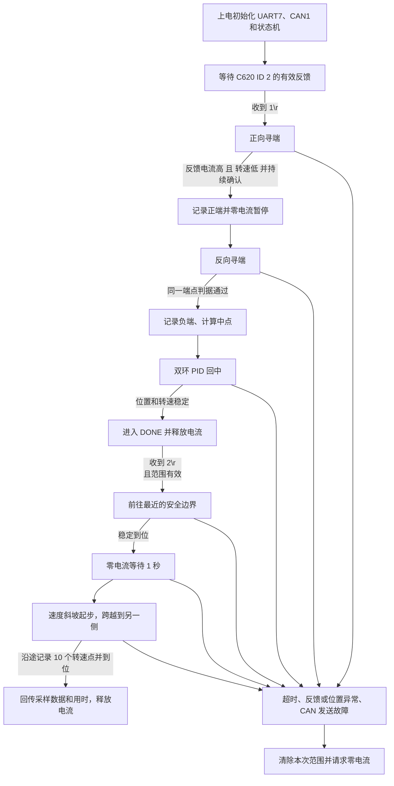

# 基地单电机寻零控制

本工程现在用于 UART7 蓝牙透传控制 CAN1 上的一台 M3508/C620（电调 ID 2）。已移除主程序中的镖架装填、发射、舵机和其他电机控制，保留原时钟与串口/CAN 引脚配置。主程序仍初始化 TIM4/TIM5 外设，但当前基地控制不启动它们的 PWM 输出。

## 阅读代码的顺序

建议按下面的调用顺序阅读：

1. `Core/Src/main.c`：芯片、GPIO、CAN、UART 和 TIM 初始化，然后调用 `base_app_init()`；主循环持续调用 `base_app_poll()`。
2. `Core/Src/base_app.c`：把蓝牙文本命令排队交给主循环；CAN 中断解析 ID 2 的电机反馈；每 1 ms 调用核心状态机；将电流命令打包发到 CAN，并异步返回状态/数据。
3. `Core/Src/base_control.c`：不依赖 STM32 HAL 的核心算法。这里维护多圈位置、PID、寻零与回中流程，以及可选的跨行程测速流程。
4. `Core/Inc/base_control.h`：状态和数据结构，以及所有主要速度、电流、计时、位置阈值宏。首次实机调参优先看这里。

整套程序的方向是：**UART 命令 → 主循环控制状态机 → 双环 PID 算出电流 → CAN 0x200 发给 C620；电机以 CAN 0x202 回报角度/速度/电流 → CAN 中断更新反馈 → 下一个 1 ms 控制周期继续闭环。**

图中的“反馈电流高且转速低”指 C620 实际回传的数值同时达到阈值，不能把程序输出的 `ICMD` 当作电流传感值。`1\r\n` 是寻零命令；`2\r\n` 是寻零成功后才可运行的测速跨越命令。

## 接线和使用

- UART7：PE8 TX、PE7 RX，115200、8 数据位、无校验、1 停止位。
- CAN1：PD0 RX、PD1 TX，沿用原工程 1 Mbit/s 配置。电调设置 ID 2，反馈使用默认 1 kHz。
- 发送 ASCII `1\r\n`（十六进制 `31 0D 0A`），开始寻零。这里的 `\r\n` 是两个换行控制字符，不是四个可见字符。
- 成功寻零后发送 `2\r\n`，先移动到离当前位置最近的安全边界（距机械端点为测得总行程的 1%），零电流等待 1 秒，再以最高 8000 rpm 移动到对侧的 1% 安全边界。指令 2 从静止加速时使用 40000 rpm/s 的短斜坡，约 200 ms 到达最高速度；接近目标时允许立即降速。跨越阶段会在 1%～99% 的执行行程上均匀记录 10 个位置的 C620 实际反馈转速，并在完成后返回各点数据和跨越用时。未寻零时拒绝执行。
- 发送 `0\r\n` 同时翻转板卡上的 PE11、PF14 LED，并返回 `CMD 0 LED TOGGLED`。**0 不是停止指令。** 原镖架其他命令不再生效。
- 调试信息上电默认关闭。发送 `9\r\n` 开启每秒 5 条的调试信息，再次发送 `9\r\n` 关闭。
- 初始化完成后，串口只主动发送一次 `READY\r\n`。
- 上电只发送零电流，不自动运动。必须先收到有效电机反馈，再接受寻零命令。

正向以正转速指令定义，不预设机构的实际左/右方向。寻零顺序为正向碰限位、记录正端、零电流暂停 100 ms、反向碰限位、记录负端、计算两端编码器位置的算术中点、位置闭环回中。中点附近速度和位置连续满足条件 100 ms 后，发送零电流并退出闭环；被外力移动后不会自动纠正。

端点同时要求：**电调实际反馈电流绝对值达到阈值、反馈转速绝对值足够低、条件连续成立**。每个寻端方向有独立的启动屏蔽时间。使用跨圈后的编码器计数记录位置，包含圈内增量与正反跨圈增量。

端点和中点只保存在 RAM，不写 Flash。每次收到有效的新寻零命令，重新建立本次坐标并重新测量整个范围；完成后保留本次结果供查看，故障则清空。中点不改写为编码器零点；可由 `当前位置 - MID` 得到相对中点位置。

## 调整参数

参数集中在 `Core/Inc/base_control.h`。以下都是首版调试值，尚未经过基地实机标定。

| 宏 | 默认值 | 含义 |
| --- | ---: | --- |
| `BASE_HOME_SPEED_RPM` | 500 | 寻端转速绝对值，电机转子 rpm，不是减速箱输出轴 rpm |
| `BASE_HOME_CURRENT_LIMIT` | 4000 | 寻端电流指令幅值上限，CAN 指令原始值 |
| `BASE_HOME_CURRENT_GATE` | 2500 | 端点实际反馈电流阈值，CAN 反馈原始值 |
| `BASE_HOME_STOP_SPEED_RPM` | 50 | 判定端点的最大转速绝对值 |
| `BASE_HOME_CONFIRM_MS` | 200 | 端点条件必须连续成立的时间 |
| `BASE_HOME_BLANK_MS` | 300 | 每次开始寻端时不判定端点的时间 |
| `BASE_HOME_TIMEOUT_MS` | 90000 | 每个方向分别计时的寻端超时 |
| `BASE_REVERSE_PAUSE_MS` | 100 | 正端确认后零电流等待时间 |
| `BASE_CENTER_TOLERANCE` | 500 | 回中允许的位置误差，转子编码器计数 |
| `BASE_CENTER_SPEED_RPM` | 4000 | 指令 1 回中阶段的转子转速上限 |
| `BASE_CENTER_STOP_SPEED_RPM` | 30 | 回中到位要求的转速上限 |
| `BASE_CENTER_STABLE_MS` | 100 | 回中到位条件的连续确认时间 |
| `BASE_CENTER_TIMEOUT_MS` | 90000 | 回中阶段超时 |
| `BASE_MIN_TRAVEL_COUNTS` | 2001 | 最小有效行程，用于拒绝同处卡死或异常方向；需按实际机构调整 |
| `BASE_TRAVERSE_MARGIN_PERCENT` | 1 | 指令 2 的两端安全余量，占寻零总行程的百分比 |
| `BASE_TRAVERSE_TOLERANCE_DIVISOR` | 4 | 指令 2 到位容差为安全余量的四分之一，且至少 1 个计数 |
| `BASE_TRAVERSE_NEAR_SPEED_RPM` | 8000 | 指令 2 移向最近安全边界的转子转速上限 |
| `BASE_TRAVERSE_FAST_SPEED_RPM` | 8000 | 指令 2 跨越到另一侧的转子转速上限 |
| `BASE_TRAVERSE_ACCEL_RPM_PER_S` | 40000 | 指令 2 从静止加速时的速度指令斜率；8000 rpm 约需 200 ms |
| `BASE_TRAVERSE_WAIT_MS` | 1000 | 到达最近安全边界后的零电流等待时间 |
| `BASE_TRAVERSE_TIMEOUT_MS` | 30000 | 指令 2 每段位置运动的超时时间 |
| `BASE_TRAVERSE_SAMPLE_COUNT` | 10 | 指令 2 跨越阶段均匀记录的转速点数，包含两端 |
| `BASE_FEEDBACK_TIMEOUT_MS` | 20 | 反馈最大间隔；短间隔漏帧使用 C620 转速辅助多圈解算 |
| `BASE_MAX_TRACKED_SPEED_RPM` | 10000 | 超过此转速时将位置累计标记为不可信 |
| `BASE_CAN_TX_TIMEOUT_MS` | 20 | 连续无成功发送时中止运动 |
| `BASE_DEBUG_PERIOD_MS` | 200 | 调试输出周期；即开启后每秒 5 条 |

电流阈值不是安培数。根据实际机构空载/正常负载运行和接触限位时的 `IFB` 调整阈值，结合 `V` 检查低速条件；同时确认限流下电机仍有足够力矩推动机构。不能只凭 `ICMD` 设置端点判据。

转子每圈为 8192 计数，机构行程需要结合减速比和机械传动换算。本版使用相邻两帧的 C620 转速估算位移，辅助选择正确的编码器圈数，可容忍不超过 20 ms 的短时调度或反馈抖动；更长中断、超速和计数溢出仍会报错。**不要直接把反馈超时改回旧工程的 500 ms**，长时间断帧仍可能无法可靠恢复整圈位置。

原 3508 PID 增益和内部限幅保持不变，控制周期仍为 1 ms：

| 环路 | Kp | Ki | Kd | 积分累积限幅 | P 项限幅 | I 项限幅 | 输出限幅 |
| --- | ---: | ---: | ---: | ---: | ---: | ---: | ---: |
| 位置环 | 0.1 | 0.01 | 0.01 | 100 | 4000 | 100 | 4000 rpm |
| 速度环 | 25 | 0.1 | 0.01 | 100000 | 16384 | 6000 | 16384 |

寻端在原速度环输出之后额外限流到 `BASE_HOME_CURRENT_LIMIT`；回中仍使用上述原双环参数和限幅。回中不使用旧工程的堵转加力功能。端点条件只能识别“持续高电流、低转速”，不能区分真实机械端点与行程中异物卡住；最小行程检查只能排除一部分异常，需要在实机确认两侧限位和正常行程。

## 串口回复

| 回复 | 含义 |
| --- | --- |
| `READY` | 板卡初始化完成，仅在上电启动后发送一次 |
| `CMD 1 START` | 接受命令，开始正向寻端 |
| `END POS=...` | 正向端点确认 |
| `SEEK NEG` | 开始反向寻端 |
| `RANGE NEG=... POS=... MID=...` | 两端有效，准备回中 |
| `CMD 1 DONE RELEASED` | 稳定到位，已请求零电流并退出闭环 |
| `CMD 2 START NEAR=... FAR=...` | 指令 2 已启动，给出先后两个安全边界目标 |
| `CMD 2 NEAR DONE WAIT 1S` | 已到达最近安全边界，开始等待 1 秒 |
| `CMD 2 GO FAR=... RECORD START POINTS=10` | 等待结束，开始跨越并记录 10 点转速 |
| `CMD 2 DATA P1=位置,转速 ...` | 均匀采样结果；位置为累计编码器计数，转速为 C620 反馈 rpm，正负号表示方向 |
| `CMD 2 DONE TIME=...MS RELEASED` | 已到达对侧并释放电机；TIME 为从开始跨越到首次到位的时间 |
| `CMD 2 ERROR NOT_HOMED` | 尚无有效寻零行程，必须先执行指令 1 |
| `CMD 2 ERROR MOVE_TIMEOUT` | 某段运动未在规定时间内到位 |
| `BUSY` | 指令到达时已有待执行/正在执行的寻零，继续原流程 |
| `CMD 0 LED TOGGLED` | PE11、PF14 LED 已完成一次电平翻转 |
| `DEBUG ON 5HZ` | 已开启调试信息，每秒 5 条 |
| `DEBUG OFF` | 已关闭调试信息 |
| `CMD 1 ERROR FEEDBACK_TIMEOUT` | 无反馈或反馈间隔超过 20 ms |
| `CMD 1 ERROR POSITION_INVALID` | 超速、异常编码器角度、圈数歧义或计数溢出 |
| `CMD 1 ERROR HOME_TIMEOUT` | 某一方向寻端超时 |
| `CMD 1 ERROR INVALID_RANGE` | 两端方向错误或行程过短 |
| `CMD 1 ERROR CENTER_TIMEOUT` | 未在规定时间内稳定回中 |
| `CMD 1 ERROR CAN_TX` | CAN 持续发送失败或进入 bus-off |
| `ERROR COMMAND` | 非法或超长命令帧 |
| `ERROR RX_QUEUE_FULL` | 输入命令过密，接收队列溢出 |

运动故障消息会追加 `TEC=... REC=... LEC=... BOFF=... MAXGAP=...MS`。TEC/REC 是 bxCAN 发送/接收错误计数器，LEC 是最近一次 CAN 错误码，BOFF 表示是否进入 bus-off，MAXGAP 是本次动作中有效电机反馈的最大帧间隔（故障时仍未恢复则包含当前断帧时长）。

`DBG S=... P=... V=... IFB=... ICMD=... ONLINE=... VALID=...` 分别表示状态、累计位置、转子转速、实际反馈电流、指令电流、反馈是否新鲜、行程是否有效。释放后的 `ICMD=0` 不代表机械制动或位置保持。

故障会清除端点/中点、退出运动并继续尝试发送零电流。CAN 物理链路断开时软件无法保证零电流送达。启用了 CAN 自动退出 bus-off；链路恢复后不会自行恢复运动，需要重新发送 `1\r\n` 完整寻零。串口错误会丢弃损坏帧直到下一次 CRLF，再接收后续完整命令。

## 文件、构建与验证

- `Core/Src/base_control.c`：与 HAL 无关的反馈解码、双环 PID、寻零状态机。
- `Core/Src/base_app.c`：UART7 收发、命令解析、CAN 收发与调试输出。
- `Core/Src/main.c`：初始化和主循环；不再包含镖架业务代码。
- `MDK-ARM/Target_Control_v1t.uvprojx`：已加入两个新源文件。
- `MDK-ARM/backup_before_base_conversion/`：修改前的 `main.c`、`can.c` 和 Keil 工程文件。
- `Tests/run_tests.ps1`：使用 PATH 中的 GCC 编译并运行控制器与 HAL 适配层的主机测试。

在 MDK-ARM 目录执行 `powershell -ExecutionPolicy Bypass -File ..\Tests\run_tests.ps1` 可重跑测试。打开原 Keil 工程即可编译；构建输出在 `MDK-ARM/Target_Control_v1t/`，构建记录在 `MDK-ARM/base_build.log`。

主机测试覆盖正反跨圈、圈内位置增量、实际电流解析、完整寻端/回中/释放、短时电流及速度干扰、超时、计时器回绕、异常行程、重复命令、串口分包/超长帧/队列溢出、串口错误恢复，以及 CAN 接受发送但实际失败和停止时撤销旧指令。它们不代替实机的 PID、机械限位、电流阈值和 CAN 总线验证。本次没有下载固件或驱动真实电机。

CAN 字节布局和反馈定义核对来源：[RoboMaster C620 官方使用说明 V1.01，第 14–17 页](https://cdn-hz.robomaster.com/robomasters/public/document/RoboMaster%20C620%20Brushless%20DC%20Motor%20Speed%20Controller%20V1.01.pdf)。
